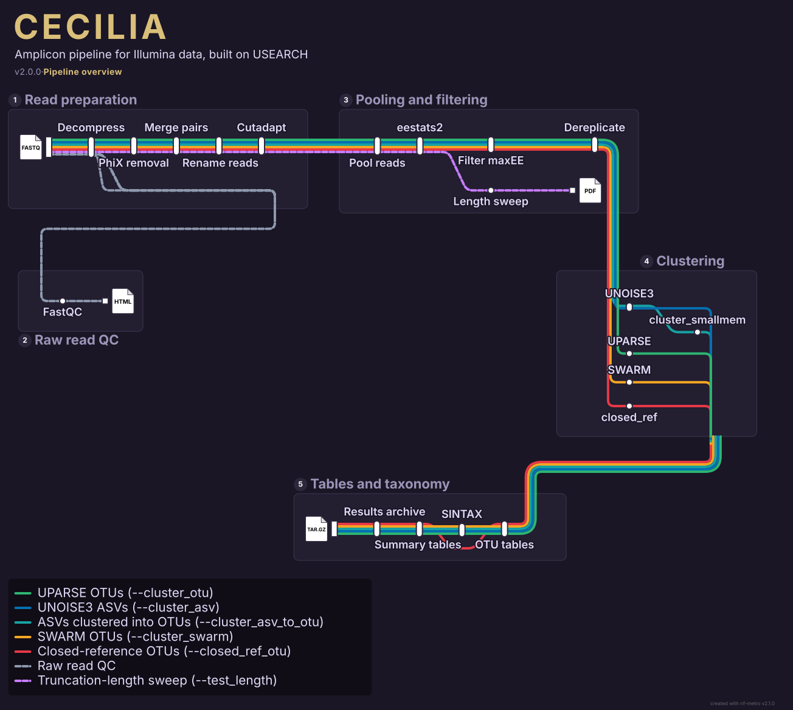

# CECILIA

<!-- badges: start -->
[](https://github.com/Gian77/CECILIAv2)
[](https://github.com/Gian77/CECILIAv2/releases)
[](https://github.com/Gian77/CECILIAv2/releases)
[](https://github.com/Gian77/CECILIAv2/issues)
<!-- badges: end -->

<p align="center">
  
</p>

`CECILIA` is a [Nextflow](https://www.nextflow.io/) DSL2 pipeline for Illumina amplicon data (16S, ITS,
18S). It takes paired-end or single-end reads through quality control, read merging, primer removal and
expected-error filtering, then builds OTU and ASV tables with up to five clustering methods side by side and
assigns taxonomy with SINTAX. Every step runs as its own SLURM job in a container, so samples and truncation
lengths run in parallel. Version 2 replaces the 18 sequential SLURM scripts of the original CECILIA with a
single workflow. The name is an acronym: **u**sear**C**h bas**E**d ampli**C**on p**I**pe**L**ine for
**I**llumina d**A**ta.

## Contents

- [Contact](#contact)
- [What CECILIA does](#what-cecilia-does)
- [Workflow DAG](#workflow-dag)
- [Key parameters](#key-parameters)
- [Directory structure expected](#directory-structure-expected)
- [Running](#running)
- [Results](#results)
- [Choosing truncation lengths](#choosing-truncation-lengths)
- [Primer pairs](#primer-pairs)
- [Resources (configured in nextflow.config)](#resources-configured-in-nextflowconfig)
- [HPC notes](#hpc-notes-msu-icer--slurm)
- [Containers and USEARCH](#containers-and-usearch)
- [Known limitations](#known-limitations)
- [Clean up](#clean-up)
- [References](#references)

## Contact

Gian M. N. Benucci, Ph.D. — [benucci@msu.edu](mailto:benucci@msu.edu) — Michigan State University

## What CECILIA does

With the default settings:

**Read preparation (per sample)**

1. **Decompress:** accepts `.gz`, `.bz2` or plain FASTQ, and renames `_1`/`_2` suffixes to `R1`/`R2`.
2. **Raw read QC:** FastQC on all R1 reads together and all R2 reads together, plus `usearch -fastx_info`.
   This branch does not hold up the rest of the workflow.
3. **PhiX removal:** `usearch -filter_phix` on both reads of a pair.
4. **Merging (`--assemble`):** `usearch -fastq_mergepairs` joins each read pair.
5. **Renaming (`--rename`):** all samples are collected and renamed to `sample001`, `sample002`, …, so
   every read header carries its sample. `file_mapping.txt` records the original file names.
6. **Primer removal (`--primers`):** Cutadapt removes the forward primer and the reverse-complemented
   reverse primer (`-e 0.01`, `-n 2`) and discards reads where no primer is found.

**Pooling and filtering**

7. **Pooling:** all samples go into one `pooled.fastq`. seqtk draws a 500-read FASTA subset for checks.
8. **Expected errors:** `usearch -fastq_eestats2` tabulates expected errors by read length. With
   `--stripleft`, a fixed number of 5' bases is removed first.
9. **Length sweep (optional, `--test_length`):** filters, dereplicates and clusters at every length from
   150 to 300 bp, and plots the counts with R, to help choose truncation lengths.
10. **Filtering:** `usearch -fastq_filter` with `--max_eerr` and no Ns, once for each truncation length in
    `--filter_lengths` plus `--user_length`, in parallel. Reads shorter than the length are discarded.
    FastQC runs on each filtered set. A length where no read survives is skipped, not failed.
11. **Dereplication:** `usearch -fastx_uniques`. With `--cluster_swarm`, SWARM (`-d 0`) also writes a
    linearised copy for SWARM clustering.

**Clustering and OTU tables (per truncation length)**

12. **UPARSE (`--cluster_otu`):** `usearch -cluster_otus` at 97%, OTUs labelled `otu_N`.
13. **UNOISE3 (`--cluster_asv`):** `usearch -unoise3` with `--zotu_min_size`, giving ASVs (zOTUs).
14. **ASVs to OTUs (`--cluster_asv_to_otu`):** the UNOISE3 ASVs are sorted by length and clustered at
    `--clustering_id` with `usearch -cluster_smallmem`.
15. **SWARM (`--cluster_swarm`):** SWARM `d=1` with `--fastidious`, then UNOISE3 on the SWARM seeds to
    remove chimeras. Clusters are labelled `swarm_NNN`.
16. **Closed reference (`--closed_ref_otu`):** `usearch -closed_ref` against `--closedRef_db`. The
    reference sequences that were hit are then matched against the labelled pooled reads, so the table
    has real per-sample counts.
17. **OTU tables:** each method maps the pooled reads back to its sequences with `usearch -otutab`.

**Taxonomy and results**

18. **SINTAX (`--sintax_taxonomy`):** `--sintax_db` is indexed once with `usearch -makeudb_usearch`, then
    `usearch -sintax` classifies every OTU and ASV set in parallel, with `--sintax_cutoff`. The
    closed-reference table is not classified, because its OTUs are the reference sequences.
19. **Summary tables (`--summary_table`):** `read_tracking.tsv` follows each sample from raw reads to
    primer-stripped reads, and `otu_summary.tsv` gives reads and OTUs per sample, length and method.
20. **Archive:** QC reports, OTU and ASV sequences, tables, taxonomy and summaries are packed into one
    dated `Cecilia-results_<marker>_<date>.tar.gz`.

## Workflow DAG

<p align="center">
  
</p>

Each line follows one clustering method through the stations that produce it, and dashed lines are
side branches. The map simplifies some details:

- Merging, renaming and primer removal can each be turned off. The lines still pass through them.
- Filtering and dereplication run once for each truncation length, and so does everything after them.
- Each clustering method builds its own OTU table with `usearch -otutab`. The map draws this as one
  "OTU tables" station in section 5.
- The closed-reference line goes around SINTAX, because its OTUs are the reference sequences.
- The summary tables step reads all five tables, while the archive also holds the SINTAX results.
- FastQC also runs on each filtered read set in section 3.

For the full process-level graph of a run, open `cecilia_dag.html` in the output directory.

The map is drawn with [nf-metro](https://github.com/seqeralabs/nf-metro) from
[`docs/images/cecilia_metro.mmd`](docs/images/cecilia_metro.mmd). After changing the workflow, update that
file and render it again. nf-metro draws only a one-line title, so a second command adds the CECILIA
header (name in the logo colours, description, and the version from `manifest.version` in
`nextflow.config`):

```bash
# One-time setup: nf-metro is on bioconda. The map was drawn with version 2.1.0
conda create -n nf-metro -c conda-forge -c bioconda nf-metro=2.1.0

conda activate nf-metro
nf-metro render docs/images/cecilia_metro.mmd --embed-font --font-scale 1.3 --x-spacing 70 \
  --section-x-gap 30 -o docs/images/cecilia_metro.svg
python3 docs/images/metro_header.py docs/images/cecilia_metro.svg nextflow.config
```

nf-metro prints layout warnings on every render. Look for `crosses non-consumer station` or
`Tier-A invariants` in its output: those mean a line is drawn through a station it does not stop at.
The router is sensitive to the structure of the map: for example, a shared station that several lines
join from different stations can make a line run through another station.

## Key parameters

All parameters live in the `params {}` block of `nextflow.config`, and any of them can be set on the
command line. `nextflow run cecilia.nf --help` prints the full list.

### Inputs and outputs

| Parameter | Default | Notes |
|---|---|---|
| `--rawdata` | `${projectDir}/rawdata` | Directory with the input FASTQ files |
| `--outdir` | `${projectDir}/outputs` | Results directory. Put it on scratch for large runs |
| `--paired` | `true` | `true` for R1 + R2 pairs, which needs `--assemble true`. `false` for single-end reads, or R1 only when pairs do not merge |
| `--dna_marker` | `16S` | Label used in output names, such as the archive |
| `--help` | `false` | Print the usage message and exit |

### Tools and databases

| Parameter | Default | Notes |
|---|---|---|
| `--usearch` | `${projectDir}/.tools/usearch11.0.667_i86linux64` | USEARCH binary. Downloaded on first run |
| `--usearch_fetch` | `true` | Allow that download. `false` stops the run if the binary is missing |
| `--sintax_db` | SILVA 138 SINTAX FASTA on GLBRC storage | Reference FASTA for SINTAX, plain or `.gz` |
| `--closedRef_db` | SynCom reference FASTA on GLBRC storage | Reference FASTA for closed-reference OTUs. Must be a real path: see [HPC notes](#hpc-notes-msu-icer--slurm) |

### Read preparation

| Parameter | Default | Notes |
|---|---|---|
| `--assemble` | `true` | Merge read pairs |
| `--min_overlap` | `0` | Minimum overlap for merging (`-fastq_minovlen`). `0` keeps the USEARCH default of 16 bp |
| `--rename` | `true` | Rename reads to `sample001`, `sample002`, … |
| `--count_start` | `01` | Number of the first renamed sample |
| `--primers` | `true` | Remove primers with Cutadapt. With `false`, reads pass through unchanged |
| `--fwd_primer` | `GTGCCAGCMGCCGCGGTAA` | 515F. See [Primer pairs](#primer-pairs) |
| `--rev_primer` | `GGACTACHVGGGTWTCTAAT` | 806R. Recorded for reference: Cutadapt uses `--rev_primer_rc` |
| `--rev_primer_rc` | `ATTAGAWACCCBDGTAGTCC` | Reverse complement of `--rev_primer`, the one Cutadapt searches for |
| `--stripleft` | `false` | Remove a fixed number of 5' bases before filtering |
| `--stripleft_bp` | `0` | Number of bases to remove |

### Filtering

| Parameter | Default | Notes |
|---|---|---|
| `--max_eerr` | `1.0` | Maximum expected errors per read |
| `--filter_lengths` | `[200, 225, 250]` | Truncation lengths. **Check these for your amplicon**: see [Choosing truncation lengths](#choosing-truncation-lengths) |
| `--user_length` | `290` | One more truncation length, added to the list |
| `--test_length` | `false` | Run the 150–300 bp length sweep |

### Clustering and taxonomy

| Parameter | Default | Notes |
|---|---|---|
| `--cluster_otu` | `true` | UPARSE OTUs |
| `--otu_min_size` | `1` | Minimum abundance of a unique sequence for UPARSE |
| `--cluster_asv` | `true` | UNOISE3 ASVs |
| `--zotu_min_size` | `8` | Minimum abundance of a unique sequence for UNOISE3 |
| `--cluster_asv_to_otu` | `true` | Cluster ASVs into OTUs. Needs `--cluster_asv` |
| `--clustering_id` | `0.97` | Identity for ASV-to-OTU and closed-reference clustering |
| `--cluster_swarm` | `true` | SWARM OTUs |
| `--closed_ref_otu` | `true` | Closed-reference OTUs against `--closedRef_db` |
| `--sintax_taxonomy` | `true` | SINTAX taxonomy |
| `--sintax_cutoff` | `0.8` | SINTAX bootstrap cutoff |
| `--summary_table` | `true` | `read_tracking.tsv` and `otu_summary.tsv` |

### SLURM

| Parameter | Default | Notes |
|---|---|---|
| `--slurm_account` | `glbrc` | Account charged for every task |

## Directory structure expected

You provide the FASTQ files in `rawdata/` and the two reference databases. The other files come with the
repository, and USEARCH is downloaded into `.tools/` on the first run.

```text
CECILIAv2/
├── cecilia.nf                  # the workflow: entry point, help, run summary and all module wiring
├── nextflow.config             # parameters, per-process resources, containers and profiles
├── run_cecilia.sb              # SLURM job that runs the Nextflow head process
├── lib/
│   └── Utils.groovy            # shared helpers: parameter coercion, USEARCH download
├── modules/                    # one process per file
│   ├── decompress.nf           # step 1
│   ├── fastqc.nf               # step 2
│   ├── remove_phix.nf          # step 3
│   ├── assemble_reads.nf       # step 4
│   ├── rename_reads.nf         # step 5
│   ├── strip_primers.nf        # step 6
│   ├── pool_reads.nf           # step 7
│   ├── ee_stats.nf             # step 8
│   ├── test_length.nf          # step 9
│   ├── filter_maxee.nf         # step 10
│   ├── dereplicate.nf          # step 11
│   ├── cluster_uparse.nf       # step 12
│   ├── cluster_unoise.nf       # step 13
│   ├── cluster_asv_to_otu.nf   # step 14
│   ├── cluster_swarm.nf        # step 15
│   ├── closed_ref_otu.nf       # step 16
│   ├── build_sintax_db.nf      # step 18
│   ├── taxonomy_sintax.nf      # step 18
│   ├── summarize_counts.nf     # step 19
│   └── collect_results.nf      # step 20
├── bin/                        # on the PATH of every task
│   ├── compareSeqQual.sh       # read-quality comparison for eestats2
│   ├── summarizeCounts.sh      # read_tracking.tsv and otu_summary.tsv
│   └── testLength.R            # length-sweep plots
├── docs/images/                # workflow metro map and its source
├── .tools/                     # USEARCH, downloaded on the first run
└── rawdata/                    # you provide
    ├── SampleA_R1_001.fastq.gz
    ├── SampleA_R2_001.fastq.gz
    └── ...
```

Paired files are matched by `*_{R1,R2}*.fastq{,.gz,.bz2}`, and the part before `_R1`/`_R2` becomes the
sample name. In single-end mode (`--paired false`), every `*.fastq{,.gz,.bz2}` file is one sample.

## Running

### Create the Nextflow conda environment

CECILIA needs Nextflow, Java and Apptainer (Singularity). All other tools run in containers, and USEARCH is
downloaded automatically, so you install only this one environment:

```bash
module purge
module load Miniforge3
conda create -n nextflow -c conda-forge -c bioconda nextflow openjdk=21
conda activate nextflow

nextflow -version
```

On the MSU HPCC, Apptainer is already installed on the compute nodes. `nextflow.config` asks for Nextflow
24.04.0 or later. The current results were produced with 26.04.3.

### Check the setup

Run these on a development node, not a gateway node:

```bash
# Check that the configuration parses
nextflow config

# Check the wiring without running any process
nextflow run cecilia.nf -preview
```

### Run as a batch job (recommended)

`run_cecilia.sb` runs the Nextflow head process as a SLURM job, so it survives when you log out. The head
process then submits each step as its own SLURM job. Run it from the repository directory. Options are
passed straight to `nextflow run`:

```bash
sbatch run_cecilia.sb \
    --dna_marker ITS \
    --fwd_primer CTTGGTCATTTAGAGGAAGTAA \
    --rev_primer TCCTCCGCTTATTGATATGC \
    --rev_primer_rc GCATATCAATAAGCGGAGGA \
    --sintax_db /path/to/UNITE_sintax.fasta \
    --closed_ref_otu false
```

For anything larger than a test set, put the work and output directories on scratch:

```bash
sbatch run_cecilia.sb \
    -work-dir /mnt/scratch/$USER/cecilia_work \
    --outdir /mnt/scratch/$USER/cecilia_outputs
```

The log goes to `cecilia_nf-<jobid>.log` in the launch directory. The `--time` in `run_cecilia.sb`
(3 h 59 min) limits the head process, not the individual steps, so raise it for large runs.

### Run interactively

From a development node, inside `tmux` so the head process keeps running if your connection drops. Steps
are still submitted to SLURM, so the head process itself uses little:

```bash
ssh dev-amd20
tmux new -s cecilia
cd /path/to/CECILIAv2
module purge
module load Miniforge3
conda activate nextflow

nextflow run cecilia.nf --dna_marker 16S
```

Press `Ctrl-B`, then `D` to detach and leave it running. To reconnect later, log in to the same
development node and run `tmux attach -t cecilia`.

### Resume after a failure

Add `-resume` to the same command, with the same work directory. Nextflow reuses cached tasks and reruns
only what changed or failed:

```bash
sbatch run_cecilia.sb -resume
sbatch run_cecilia.sb -resume <session-id>   # a specific earlier run, from .nextflow/history
```

### Useful Nextflow options

These take a single dash, unlike pipeline parameters:

| Option | Effect |
|---|---|
| `-resume` | Reuse cached results from an earlier run |
| `-work-dir <dir>` | Where task directories go. Default is `work/` in the launch directory |
| `-profile local` | Run every step on the current node instead of submitting to SLURM |
| `-profile test` | Like `local`, with `--test_length` and `--cluster_swarm` off |
| `-ansi-log false` | Plain log output, better for files |

`local` and `test` also turn off Apptainer, so FastQC, Cutadapt, seqtk, SWARM and R must already be on
your `PATH`. They are meant for checking the wiring, not for real runs.

## Results

Every output folder is numbered by the step that writes it:

| Path | Contents |
|---|---|
| `01_decompressed/` | Decompressed FASTQ files |
| `02_rawQuality_fqc/` | FastQC reports for R1 and R2, and `fastq_info/` from USEARCH |
| `03_removePhix_usearch/` | Reads after PhiX removal |
| `04_readAssembly_usearch/` | Merged reads |
| `05_readRenamed_bash/` | Renamed reads and `file_mapping.txt` |
| `06_primerStrip_cutadapt/` | Primer-stripped reads, `pooled.fastq` and `subset_500.fasta` |
| `07_readTrimDemux_usearch/` | `eestats2.results`, and `trimmed.fastq` with `--stripleft` |
| `08_testLength_usearch/` | Length-sweep table and plots (`--test_length`) |
| `09_filterMaxee_usearch/` | Filtered reads and FastQC reports, per length |
| `10_dereplicateReads_usearch/` | Unique sequences, per length |
| `11_clustered_otu_asv_usearch/` | Sequences and tables for every clustering method, per length (see below) |
| `13_taxonomy_sintax/` | SINTAX results, one `.sintax` file per sequence set |
| `14_getResults_bash/` | `Cecilia-results_<marker>_<date>.tar.gz` |
| `stats/` | Read counts after each step, `read_tracking.tsv` and `otu_summary.tsv` |
| `cecilia_report.html`, `cecilia_timeline.html`, `cecilia_dag.html` | Nextflow execution records |

In `11_clustered_otu_asv_usearch/`, for each truncation length `<len>`:

| Method | Sequences | Table |
|---|---|---|
| UPARSE | `otus_<len>bp.fasta` | `otutable_UPARSE_<len>bp.txt` |
| UNOISE3 | `asv_<len>bp.fasta` | `asvtable_UNOISE_<len>bp.txt` |
| ASVs to OTUs | `asv_<len>bp_to97otus.fasta` | `otutable_asv_<len>bp_to97otus.txt` |
| SWARM | `swarms_<len>bp.fasta` | `otutable_SWARM_<len>bp.txt` |
| Closed reference | | `otutable_<len>bp_closedRef.txt` |

Intermediate files for each method are in `extra/`. The archive in `14_getResults_bash/` holds the
sequences, tables, taxonomy, QC reports and summary tables in one small download, without the read files.

## Choosing truncation lengths

`usearch -fastq_trunclen` discards every read shorter than the truncation length, so a length above the
real amplicon size silently removes reads. The default lengths (200, 225, 250 and 290 bp) suit short
amplicons such as 16S V4. For longer amplicons, set your own:

- Look at the merged length distribution after primer removal, for example in `eestats2.results` or with
  `--test_length`, and choose lengths at or below the 1st percentile.
- For 16S V3-V4 (341F/806R), merged reads are about 404–431 bp after primers. A run with `400` kept all
  length classes, while `410` dropped about a third of the reads.

```bash
sbatch run_cecilia.sb --filter_lengths '[380,400]' --user_length 400
```

## Primer pairs

Common primer pairs, carried over from the original CECILIA configuration. Set `--fwd_primer`,
`--rev_primer` and `--rev_primer_rc` to switch.

| Marker | Pair | `--fwd_primer` | `--rev_primer` | `--rev_primer_rc` | Reference |
|---|---|---|---|---|---|
| 16S | 515F / 806R | `GTGCCAGCMGCCGCGGTAA` | `GGACTACHVGGGTWTCTAAT` | `ATTAGAWACCCBDGTAGTCC` | Parada et al. 2016; Apprill et al. 2015, as modified for the [EMP protocol](https://earthmicrobiome.org/protocols-and-standards/16s/). **Default** |
| 16S | 27F / 1492R | `AGAGTTTGATCMTGGCTCAG` | `GGTTACCTTGTTACGACTT` | `AAGTCGTAACAAGGTAACC` | Heuer et al. 1997 |
| 16S | 341F / 806R | `CCTACGGGNGGCWGCAG` (or `CCTACGGGAGGCAGCAG`) | `GGACTACHVGGGTWTCTAAT` | `ATTAGAWACCCBDGTAGTCC` | Albertsen et al. 2015 |
| ITS | ITS1F / ITS4 | `CTTGGTCATTTAGAGGAAGTAA` | `TCCTCCGCTTATTGATATGC` | `GCATATCAATAAGCGGAGGA` | Gardes & Bruns 1993; White et al. 1990 |
| ITS | ITS1F / ITS2 | `CTTGGTCATTTAGAGGAAGTAA` | `GCTGCGTTCTTCATCGATGC` | `GCATCGATGAAGAACGCAGC` | Gardes & Bruns 1993; White et al. 1990 |
| ITS | 5.8S-Fun / ITS4-Fun | `AACTTTYRRCAAYGGATCWCT` | `AGCCTCCGCTTATTGATATGCTTAART` | `AYTTAAGCATATCAATAAGCGGAGGCT` | Taylor et al. 2016 |
| ITS | ITS5-1737F / ITS2-2043R | `GGAAGTAAAAGTCGTAACAAGG` | `GCTGCGTTCTTCATCGATGC` | `GCATCGATGAAGAACGCAGC` | Novogene ITS primer set |
| LSU (28S) | LR0R / LR3 | `ACCCGCTGAACTTAAGC` | `CCGTGTTTCAAGACGGG` | `CCCGTCTTGAAACACGG` | Vilgalys & Hester 1990; Rehner & Samuels 1994 |
| AMF (18S) | SSUmCf / LSUmBr | `TATYGYTCTTNAACGAGGAATC` | `AACACTCGCAYAYATGYTAGA` | `TCTARCATRTRTGCGAGTGTT` | Krüger et al. 2009 |

Full citations are in [References](#primers).

## Resources (configured in nextflow.config)

Each process has its own `withName:` block in `nextflow.config`, which sets the CPUs, memory, time limit
and container that Nextflow requests for it. To change what a step gets, edit its block.

| Process | CPUs | RAM | Time | Retries |
|---|---:|---:|---:|---:|
| `DECOMPRESS` | 16 | 64 GB | 15 min | |
| `FASTQC` | 8 | 32 GB | 1 h | 1 |
| `REMOVE_PHIX` | 8 | 32 GB | 30 min | |
| `ASSEMBLE_READS` | 16 | 128 GB | 12 h | |
| `RENAME_READS` | 8 | 32 GB | 30 min | |
| `STRIP_PRIMERS` | 16 | 32 GB | 30 min | |
| `POOL_READS` | 4 | 16 GB | 15 min | |
| `EE_STATS` | 8 | 32 GB | 4 h | |
| `TEST_LENGTH` | 16 | 128 GB | 4 h | |
| `FILTER_MAXEE` | 8 | 32 GB | 1 h | |
| `DEREPLICATE` | 8 | 32 GB | 4 h | |
| `CLUSTER_UPARSE` | 32 | 256 GB | 10 h | 2 |
| `CLUSTER_UNOISE` | 16 | 128 GB | 10 h | 2 |
| `CLUSTER_ASV_TO_OTU` | 16 | 128 GB | 4 h | 2 |
| `CLOSED_REF_OTU` | 16 | 128 GB | 4 h | 2 |
| `CLUSTER_SWARM` | 16 | 64 GB | 4 h | 2 |
| `BUILD_SINTAX_DB` | 4 | 32 GB | 1 h | |
| `TAXONOMY_SINTAX` | 32 | 392 GB | 10 h | |
| `SUMMARIZE_COUNTS` | 4 | 32 GB | 30 min | |
| `COLLECT_RESULTS` | 4 | 32 GB | 15 min | |

- **Retries:** FastQC retries once, because its bus errors on parallel filesystems are often transient. The
  clustering retries do not help with the `-otutab` crash described in
  [Known limitations](#known-limitations).
- **Other clusters:** adjust these values to your queue limits, and set `--slurm_account`.

## HPC notes (MSU ICER / SLURM)

CECILIA was developed on the MSU ICER HPCC, and so far that is the only system where it has been tested. On
other systems, expect to change `--slurm_account`, the bind paths under `singularity.runOptions` and the
database paths in `nextflow.config`.

- **Where to run:** start Nextflow from a development node (such as `dev-amd20`) or with `sbatch`, never on
  a gateway node.
- **Work directory:** a run of about 500 samples is roughly 50 times the size of the test set, which does
  not fit in a home directory. Put `-work-dir` and `--outdir` on scratch, as in
  [Run as a batch job](#run-as-a-batch-job-recommended). Avoid `/mnt/research` for the work directory: new
  task directories there were often not yet visible to the compute node that picked them up.
- **`/mnt/research` paths inside containers:** `/mnt/research` is a link farm through `/cvmfs`, which is
  not mounted inside containers on compute nodes. Paths that Nextflow stages (`--sintax_db`, `--rawdata`)
  are fine. `--closedRef_db` is opened directly by the task, so give its real path:
  `realpath /mnt/research/...` gives the `/mnt/ufs18/rs/...` form.
- **Container cache:** images are stored in `singularity.cacheDir`
  (`/mnt/research/glbrc_group/benuccigmn/singularity_cache`). The first run downloads all of them.
- **Scratch inodes:** scratch has a file-count limit, and the work directory holds many small files. Clean
  it after each run: see [Clean up](#clean-up).

## Containers and USEARCH

Every tool except USEARCH runs in a container, pinned to an exact tag in `nextflow.config`:

| Process(es) | Image |
|---|---|
| `DECOMPRESS`, `REMOVE_PHIX`, `ASSEMBLE_READS`, `RENAME_READS`, `EE_STATS`, `CLUSTER_UPARSE`, `CLUSTER_UNOISE`, `CLUSTER_ASV_TO_OTU`, `CLOSED_REF_OTU`, `BUILD_SINTAX_DB`, `TAXONOMY_SINTAX`, `SUMMARIZE_COUNTS`, `COLLECT_RESULTS` | `docker://ubuntu:22.04`, with USEARCH mounted from the host |
| `FASTQC`, `FILTER_MAXEE` | `quay.io/biocontainers/fastqc:0.12.1--hdfd78af_0` |
| `STRIP_PRIMERS` | `quay.io/biocontainers/cutadapt:5.2--py312h247cb63_1` |
| `POOL_READS` | `quay.io/biocontainers/seqtk:1.4--he4a0461_1` |
| `DEREPLICATE`, `CLUSTER_SWARM` | `quay.io/biocontainers/swarm:3.1.6--h9948957_0` |
| `TEST_LENGTH` | `docker://rocker/tidyverse:4.3.1` |

**USEARCH is downloaded, not installed.** USEARCH v11.0.667 has been in the public domain (CC0) since 2024
([`rcedgar/usearch_old_binaries`](https://github.com/rcedgar/usearch_old_binaries)). On the first run,
CECILIA downloads it into `.tools/` from a URL pinned to one commit, checks its SHA-256 before using it,
and mounts it into every container. To use your own copy, pass `--usearch /path/to/usearch`. An existing
file is never overwritten, and a checksum mismatch there only gives a warning.

**Why v11 and not v12.** USEARCH v12 is open source (GPL-3.0) but lacks five commands CECILIA uses
(`-filter_phix`, `-fastq_eestats2`, `-sortbylength`, `-fastx_getseqs`, `-fastx_info`), and its
`-closed_ref` crashes on input that v11 handles. v12 was compared step by step on a full run and
rejected. Since v11 is now public domain, v12 has no licensing advantage either.

## Known limitations

- **Unmerged pairs.** CECILIA does not process read pairs without merging them, and stops at the start
  with `--paired true --assemble false`. When pairs do not merge, as for most ITS and LSU amplicons with
  2 × 300 bp reads, run on R1 only with `--paired false`.
- **Empty results.** A clustering method that finds no OTUs at some truncation length gives a table
  with only a header row and an empty SINTAX file, and the run continues.
- **Truncation lengths are not checked.** The default `--filter_lengths` silently discards long reads
  for amplicons longer than about 300 bp: see
  [Choosing truncation lengths](#choosing-truncation-lengths).
- **`--closedRef_db` is read directly by the task.** A wrong or `/mnt/research` path fails about an hour
  into the run, at `CLOSED_REF_OTU`, rather than at the start.
- **Reference labels.** USEARCH cuts sequence labels at the first space. A closed-reference FASTA whose
  headers contain spaces before the unique part (for example `>Bacteria; ...`) collapses into one label.
  Check that labels are unique and contain no spaces.
- **Default SINTAX database.** The default `--sintax_db` is a SILVA 138 file that still contains RNA
  bases (`U`). Use a database converted to DNA (`T`), such as a current SILVA release built for SINTAX.

## Clean up

**Delete carefully.** The work directory holds the Nextflow cache. After you remove it, the next run starts
from the beginning. Results already copied to `--outdir` do not depend on it.

```bash
# Task directories of all runs except the latest, then the latest itself
nextflow clean -f -before <latest-session>
nextflow clean -f <latest-session>

# Or remove everything
rm -rf work/ .nextflow/
rm -f .nextflow.log*

# Published results: back up anything you want to keep first
rm -rf outputs/

# Container image cache
apptainer cache list -v
```

`nextflow log` lists the runs and their session names.

## References

Please cite the tools you use. Versions are the ones pinned in `nextflow.config`.

### Workflow and containers

| Tool | Version | Reference |
|---|---|---|
| Nextflow | 26.04.3 | Di Tommaso P, et al. Nextflow enables reproducible computational workflows. *Nat Biotechnol* 2017;35:316–319. [doi:10.1038/nbt.3820](https://doi.org/10.1038/nbt.3820) |
| Apptainer (Singularity) | | Kurtzer GM, et al. Singularity: Scientific containers for mobility of compute. *PLoS ONE* 2017;12:e0177459. [doi:10.1371/journal.pone.0177459](https://doi.org/10.1371/journal.pone.0177459) |
| BioContainers | | da Veiga Leprevost F, et al. BioContainers: an open-source and community-driven framework for software standardization. *Bioinformatics* 2017;33:2580–2582. [doi:10.1093/bioinformatics/btx192](https://doi.org/10.1093/bioinformatics/btx192) |
| nf-metro | 2.1.0 | Workflow map. <https://github.com/seqeralabs/nf-metro> |

### Read processing, clustering and taxonomy

| Tool | Version | Reference |
|---|---|---|
| USEARCH | 11.0.667 | Edgar RC. Search and clustering orders of magnitude faster than BLAST. *Bioinformatics* 2010;26:2460–2461. [doi:10.1093/bioinformatics/btq461](https://doi.org/10.1093/bioinformatics/btq461) |
| Expected-error filtering and merging | 11.0.667 | Edgar RC, Flyvbjerg H. Error filtering, pair assembly and error correction for next-generation sequencing reads. *Bioinformatics* 2015;31:3476–3482. [doi:10.1093/bioinformatics/btv401](https://doi.org/10.1093/bioinformatics/btv401) |
| UPARSE | 11.0.667 | Edgar RC. UPARSE: highly accurate OTU sequences from microbial amplicon reads. *Nat Methods* 2013;10:996–998. [doi:10.1038/nmeth.2604](https://doi.org/10.1038/nmeth.2604) |
| UNOISE3 | 11.0.667 | Edgar RC. UNOISE2: improved error-correction for Illumina 16S and ITS amplicon sequencing. *bioRxiv* 2016. [doi:10.1101/081257](https://doi.org/10.1101/081257) |
| SINTAX | 11.0.667 | Edgar RC. SINTAX: a simple non-Bayesian taxonomy classifier for 16S and ITS sequences. *bioRxiv* 2016. [doi:10.1101/074161](https://doi.org/10.1101/074161) |
| Cutadapt | 5.2 | Martin M. Cutadapt removes adapter sequences from high-throughput sequencing reads. *EMBnet.journal* 2011;17:10–12. [doi:10.14806/ej.17.1.200](https://doi.org/10.14806/ej.17.1.200) |
| SWARM | 3.1.6 | Mahé F, et al. Swarm v2: highly-scalable and high-resolution amplicon clustering. *PeerJ* 2015;3:e1420. [doi:10.7717/peerj.1420](https://doi.org/10.7717/peerj.1420). Mahé F, et al. Swarm v3: towards tera-scale amplicon clustering. *Bioinformatics* 2022;38:267–269. [doi:10.1093/bioinformatics/btab493](https://doi.org/10.1093/bioinformatics/btab493) |
| FastQC | 0.12.1 | Andrews S. <https://www.bioinformatics.babraham.ac.uk/projects/fastqc/> |
| seqtk | 1.4 | Li H. <https://github.com/lh3/seqtk> |
| tidyverse (R) | rocker 4.3.1 | Wickham H, et al. Welcome to the tidyverse. *J Open Source Softw* 2019;4:1686. [doi:10.21105/joss.01686](https://doi.org/10.21105/joss.01686) |

### Databases

| Resource | Version | Reference |
|---|---|---|
| SILVA | 138 (default `--sintax_db`) | Quast C, et al. The SILVA ribosomal RNA gene database project: improved data processing and web-based tools. *Nucleic Acids Res* 2013;41:D590–D596. [doi:10.1093/nar/gks1219](https://doi.org/10.1093/nar/gks1219) |

### Primers

- Parada AE, Needham DM, Fuhrman JA. Every base matters: assessing small subunit rRNA primers for marine microbiomes with mock communities, time series and global field samples. *Environ Microbiol* 2016;18:1403–1414. [doi:10.1111/1462-2920.13023](https://doi.org/10.1111/1462-2920.13023)
- Apprill A, McNally S, Parsons R, Weber L. Minor revision to V4 region SSU rRNA 806R gene primer greatly increases detection of SAR11 bacterioplankton. *Aquat Microb Ecol* 2015;75:129–137. [doi:10.3354/ame01753](https://doi.org/10.3354/ame01753)
- Heuer H, Krsek M, Baker P, Smalla K, Wellington EMH. Analysis of actinomycete communities by specific amplification of genes encoding 16S rRNA and gel-electrophoretic separation in denaturing gradients. *Appl Environ Microbiol* 1997;63:3233–3241.
- Albertsen M, Karst SM, Ziegler AS, Kirkegaard RH, Nielsen PH. Back to basics – the influence of DNA extraction and primer choice on phylogenetic analysis of activated sludge communities. *PLoS ONE* 2015;10:e0132783. [doi:10.1371/journal.pone.0132783](https://doi.org/10.1371/journal.pone.0132783)
- Gardes M, Bruns TD. ITS primers with enhanced specificity for basidiomycetes – application to the identification of mycorrhizae and rusts. *Mol Ecol* 1993;2:113–118. [doi:10.1111/j.1365-294X.1993.tb00005.x](https://doi.org/10.1111/j.1365-294X.1993.tb00005.x)
- White TJ, Bruns T, Lee S, Taylor J. Amplification and direct sequencing of fungal ribosomal RNA genes for phylogenetics. In: Innis MA, Gelfand DH, Sninsky JJ, White TJ, eds. *PCR Protocols: A Guide to Methods and Applications*. Academic Press; 1990:315–322.
- Taylor DL, Walters WA, Lennon NJ, et al. Accurate estimation of fungal diversity and abundance through improved lineage-specific primers optimized for Illumina amplicon sequencing. *Appl Environ Microbiol* 2016;82:7217–7226. [doi:10.1128/AEM.02576-16](https://doi.org/10.1128/AEM.02576-16)
- Vilgalys R, Hester M. Rapid genetic identification and mapping of enzymatically amplified ribosomal DNA from several *Cryptococcus* species. *J Bacteriol* 1990;172:4238–4246. [doi:10.1128/jb.172.8.4238-4246.1990](https://doi.org/10.1128/jb.172.8.4238-4246.1990)
- Rehner SA, Samuels GJ. Taxonomy and phylogeny of *Gliocladium* analysed from nuclear large subunit ribosomal DNA sequences. *Mycol Res* 1994;98:625–634. [doi:10.1016/S0953-7562(09)80409-7](https://doi.org/10.1016/S0953-7562(09)80409-7)
- Krüger M, Stockinger H, Krüger C, Schüßler A. DNA-based species level detection of Glomeromycota: one PCR primer set for all arbuscular mycorrhizal fungi. *New Phytol* 2009;183:212–223. [doi:10.1111/j.1469-8137.2009.02835.x](https://doi.org/10.1111/j.1469-8137.2009.02835.x)
- ITS5-1737F / ITS2-2043R: Novogene ITS primer set, with no peer-reviewed citation.
